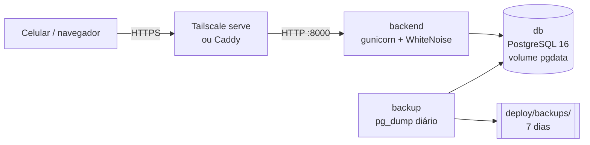

# Deploy no homelab

Como colocar o Prumo no ar num servidor de casa (ou VPS) com Docker, acessível do celular na rede de casa e, fora dela, pela VPN. Issue [#9](https://github.com/BrenoToledo/PRUMO/issues/9).

Tudo de produção fica em [`deploy/`](../deploy/):

| Arquivo | Para quê |
| --- | --- |
| `docker-compose.yml` | Banco (PostgreSQL 16), backend (gunicorn + WhiteNoise), backup diário e, opcional, o Caddy para HTTPS |
| `.env.example` | Modelo do `deploy/.env` (segredos e nomes de host) |
| `backup.sh` | `pg_dump` diário, guardando 7 dias |
| `Caddyfile` | Proxy HTTPS do perfil `https` |

O `docker-compose.yml` da raiz continua sendo o de desenvolvimento.

## O que sobe



- **backend**: a imagem é construída de `backend/Dockerfile`. No build roda `collectstatic` (arquivos com hash e versão comprimida), e o WhiteNoise serve os estáticos direto do gunicorn, sem nginx. Ao iniciar, aplica as migrações. Roda como usuário sem privilégios e com `DJANGO_DEBUG=false` fixo.
- **db**: os dados ficam no volume `prumo_pgdata`, que sobrevive a `docker compose down`, `restart` e reinício do servidor.
- **backup**: todo dia às `BACKUP_HORA` (padrão 03:00) grava `deploy/backups/prumo-AAAA-MM-DD_HHMMSS.dump` e apaga os dumps com mais de `BACKUP_RETENCAO_DIAS` (padrão 7) dias.
- Todos com `restart: unless-stopped`: voltam sozinhos depois de queda de energia.

## Primeira instalação

Pré-requisitos no servidor: Docker com o plugin `compose` e git.

```bash
git clone https://github.com/BrenoToledo/PRUMO.git prumo
cd prumo/deploy
cp .env.example .env
python3 -c "import secrets; print(secrets.token_urlsafe(50))"   # cole em DJANGO_SECRET_KEY
nano .env      # senha do banco, DJANGO_ALLOWED_HOSTS e DJANGO_CSRF_TRUSTED_ORIGINS
docker compose up -d --build
docker compose exec backend python manage.py createsuperuser
```

Confira:

```bash
docker compose ps                 # db (healthy), backend e backup em "Up"
docker compose logs -f backend    # migrações aplicadas e gunicorn ouvindo em 0.0.0.0:8000
curl -I http://localhost:8000/entrar/                  # 200
curl -I http://localhost:8000/static/web/tokens.css    # 200 (servido pelo WhiteNoise)
```

Por HTTP o login só funciona em `http://localhost:8000/` (no próprio servidor): os cookies de produção são `Secure`. Para usar de outro aparelho, configure o HTTPS abaixo.

### Variáveis do `deploy/.env`

| Variável | Exemplo | Observação |
| --- | --- | --- |
| `DJANGO_SECRET_KEY` | (aleatória, 50+ caracteres) | Obrigatória: sem ela o backend não sobe |
| `DJANGO_ALLOWED_HOSTS` | `prumo.casa.lan,servidor.tailnet.ts.net,localhost` | Todo nome usado para acessar, sem `https://` |
| `DJANGO_CSRF_TRUSTED_ORIGINS` | `https://prumo.casa.lan,https://servidor.tailnet.ts.net` | Os mesmos nomes, com `https://` (sem isso os formulários dão erro 403) |
| `DJANGO_TIME_ZONE` | `America/Sao_Paulo` | Também usado no horário do backup |
| `POSTGRES_PASSWORD` | | Obrigatória. Use só letras, números, `-` e `_` (entra no `DATABASE_URL`) |
| `PRUMO_PORTA` | `8000` ou `127.0.0.1:8000` | Com proxy HTTPS na mesma máquina, prefira `127.0.0.1:8000` |
| `BACKUP_HORA`, `BACKUP_RETENCAO_DIAS`, `PRUMO_BACKUP_DIR` | `03:00`, `7`, `./backups` | Pasta relativa a `deploy/`; aponte para outro disco se tiver |
| `DJANGO_LOG_LEVEL` | `INFO` | Opcional |
| `GUNICORN_WORKERS` | `2` | Opcional |
| `PRUMO_IA_MODELO`, `PRUMO_IA_CHAVE` | `anthropic/claude-haiku-5-5`, `sk-ant-…` | Opcional: a "IA do Prumo". Sem modelo, a IA fica desligada. `falso` demonstra sem rede |
| `PRUMO_IA_MODELO_PROPRIO`, `PRUMO_IA_CHAVE_PROPRIA` | `openai/gpt-4o-mini` | Opcional: a opção "Minha chave de API" |
| `PRUMO_IA_MODELO_LOCAL`, `PRUMO_IA_URL_LOCAL` | `ollama/llama3.2`, `http://ollama:11434` | Opcional: a opção "Modelo local" |
| `PRUMO_IA_LIMITE_DIARIO`, `PRUMO_IA_LIMITE_MENSAL_USD` | `50`, `2` | Limites por usuário: sugestões por dia e gasto por mês em dólar |

## HTTPS (obrigatório para o celular)

O Prumo em produção usa cookies `Secure`, e o navegador só instala o app na tela inicial (PWA, [#10](https://github.com/BrenoToledo/PRUMO/issues/10)) e só registra o service worker em **HTTPS** com certificado confiável (a exceção é `localhost`). Escolha uma das opções.

### Opção A (recomendada): Tailscale

Resolve o acesso de fora de casa (VPN) e o certificado de uma vez: o Tailscale emite um certificado válido para `servidor.<sua-tailnet>.ts.net`.

1. Instale o Tailscale no servidor e no celular e entre na mesma conta.
2. No painel do Tailscale, em *DNS*, ative **MagicDNS** e **HTTPS Certificates**.
3. No `deploy/.env`: `PRUMO_PORTA=127.0.0.1:8000`, e acrescente `servidor.<sua-tailnet>.ts.net` em `DJANGO_ALLOWED_HOSTS` e `https://servidor.<sua-tailnet>.ts.net` em `DJANGO_CSRF_TRUSTED_ORIGINS`. Rode `docker compose up -d` de novo.
4. No servidor: `sudo tailscale serve --bg 8000`.
5. No celular, abra `https://servidor.<sua-tailnet>.ts.net/`.

### Opção B: Caddy (perfil `https`)

Para acessar por um nome da rede local (ex.: `prumo.casa.lan`, configurado no roteador ou no Pi-hole apontando para o servidor).

1. No `deploy/.env`: `PRUMO_DOMINIO=prumo.casa.lan`, `PRUMO_TLS=internal`, `PRUMO_PORTA=127.0.0.1:8000`, e o domínio em `DJANGO_ALLOWED_HOSTS` / `DJANGO_CSRF_TRUSTED_ORIGINS`.
2. `docker compose --profile https up -d` (as portas 80 e 443 do servidor precisam estar livres).
3. `PRUMO_TLS=internal` usa uma CA própria do Caddy, que o celular não conhece. Copie a raiz e instale no Android (*Configurações → Segurança → Criptografia e credenciais → Instalar certificado → Certificado de CA*):

   ```bash
   docker compose cp caddy:/data/caddy/pki/authorities/local/root.crt ./prumo-ca.crt
   ```

Se o domínio for público (DNS apontando para um IP acessível pela internet), troque `PRUMO_TLS` por um e-mail e o Caddy usa Let's Encrypt, sem instalar nada no celular.

## Instalar no celular (PWA)

Issue [#10](https://github.com/BrenoToledo/PRUMO/issues/10). Com o HTTPS funcionando:

1. Abra o endereço HTTPS do Prumo no **Chrome do Android** e entre.
2. Menu ⋮ → **Adicionar à tela inicial** (ou **Instalar app**) → **Instalar**.
3. O ícone "P" aparece na tela inicial e abre o Prumo em tela cheia, sem a barra do navegador.

No iPhone (Safari): botão Compartilhar → **Adicionar à Tela de Início**.

Como funciona:

- `web/static/web/pwa/manifest.json`: nome, cores (`#FAFAF7` de fundo, P em `#0F766E`), `display: standalone` e ícones de 192 e 512 px (mais um *maskable* para o recorte redondo do Android). Ligado no `<head>` por `web/templates/web/_pwa_head.html`.
- `/sw.js` (rota `web:service_worker`, em `web/telas/pwa.py`): service worker mínimo. Precisa ser servido na raiz para controlar todas as páginas. Ele guarda **só os arquivos estáticos** (`/static/…`): responde do cache e atualiza em segundo plano. Páginas e API sempre vão à rede, então nenhum dado seu fica guardado no aparelho, e sem conexão o app mostra o erro normal do navegador.
- Mudou o `sw.js`? Troque o nome do cache (`prumo-estaticos-v1` → `v2`) para o navegador descartar o antigo.

Se a opção de instalar não aparecer: confira se a página abriu em HTTPS sem aviso de certificado, e no Chrome do computador abra DevTools → *Application* → *Manifest* para ver o motivo.

## Atualizar

```bash
cd prumo && git pull
cd deploy && docker compose up -d --build     # migrações rodam sozinhas ao iniciar
docker image prune -f                         # opcional: limpa imagens antigas
```

Os dados não são afetados: ficam no volume `prumo_pgdata`. Faça um backup manual antes de atualizações grandes (abaixo).

## Backup e restauração

Backup manual, a qualquer hora:

```bash
docker compose exec backup bash /backup.sh agora
ls -lh backups/
```

Copie `deploy/backups/` para outro lugar de vez em quando (outro disco, nuvem): um backup na mesma máquina não protege contra perda do disco.

Restaurar um dump (substitui os dados atuais):

```bash
docker compose stop backend
docker compose exec -T db sh -c 'pg_restore --clean --if-exists --no-owner -U "$POSTGRES_USER" -d "$POSTGRES_DB"' < backups/prumo-AAAA-MM-DD_HHMMSS.dump
docker compose start backend
```

Teste a restauração pelo menos uma vez logo após instalar: um backup que nunca foi restaurado não é um backup.

## Problemas comuns

| Sintoma | Causa provável |
| --- | --- |
| `Bad Request (400)` | O nome usado no navegador não está em `DJANGO_ALLOWED_HOSTS` |
| `403 Verificação CSRF falhou` ao entrar | Falta o endereço com `https://` em `DJANGO_CSRF_TRUSTED_ORIGINS`, ou o acesso está sendo feito por HTTP |
| Login volta para a tela de entrar | Acesso por HTTP: o cookie de sessão é `Secure` e só vai por HTTPS |
| `defina DJANGO_SECRET_KEY` nos logs | `DJANGO_SECRET_KEY` vazia no `deploy/.env` |
| `defina POSTGRES_PASSWORD` ao rodar o compose | Rodou fora de `deploy/` ou sem o `deploy/.env` |
| Página sem estilo | Imagem antiga: `docker compose up -d --build` |

## Validação

O compose foi validado com `docker compose config` (com e sem `--profile https`), e os testes em `backend/web/tests/test_deploy.py` cobrem as configurações de produção, o `collectstatic` com WhiteNoise e a retenção do `backup.sh`. A primeira subida real no homelab deve seguir a seção *Primeira instalação* e marcar os critérios da issue #9.
