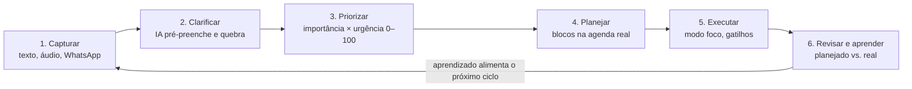
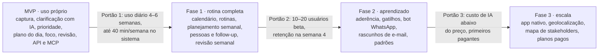
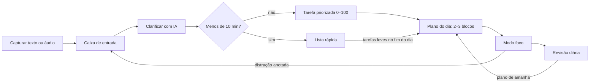
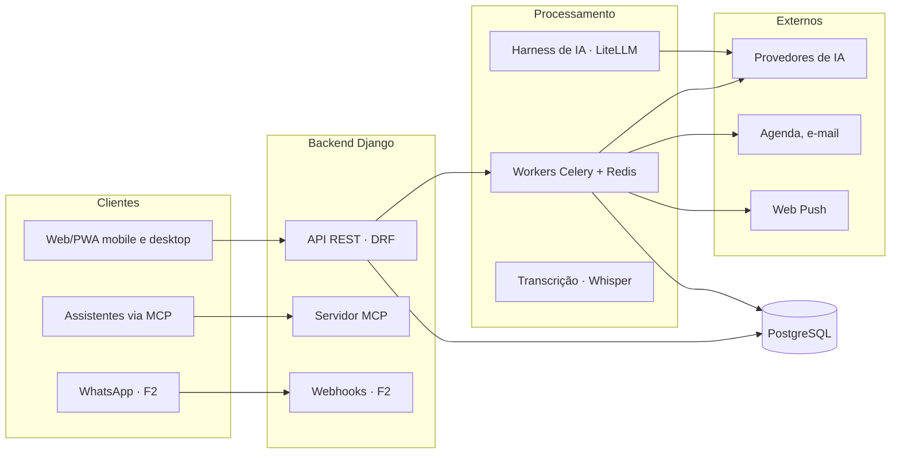
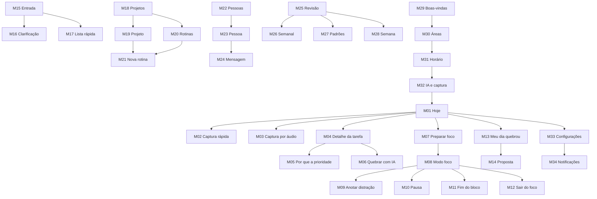

# Sistema de Gerenciamento de Tarefas com IA — Especificação e Plano

Oct 17, 2026 · @Breno Toledo

## 1. Conceitos de base

O sistema combina seis ideias consolidadas. Nenhuma é nova; o valor está em fazê-las funcionar juntas com o mínimo de esforço do usuário.

| Conceito | Origem | O que traz para o sistema |
| --- | --- | --- |
| Hiperfoco e scatter focus | *Hyperfocus*, Chris Bailey | Atenção é o recurso escasso. Trabalho profundo acontece em blocos com uma única intenção; ideias se conectam em momentos sem estímulo. |
| Matriz importância × urgência | Matriz de Eisenhower | Separar o que é importante do que apenas parece urgente. Destinos: fazer, agendar, delegar, descartar. |
| Captura e clarificação | *Getting Things Done* (GTD), David Allen | Tirar tudo da cabeça para uma caixa de entrada e decidir depois. Toda tarefa tem uma próxima ação concreta. Lista de "Aguardando" para o que depende de outros. |
| Time blocking | Prática comum de planejamento | A agenda é finita. Tarefas viram blocos de tempo reais, e não uma lista infinita. |
| Gestão de stakeholders e expectativas | PMBOK (PMI) | Identificar quem é afetado por cada entrega, planejar o engajamento, comunicar e monitorar. Expectativa não gerenciada vira conflito. |
| Formação de hábitos e falácia do planejamento | Psicologia comportamental | Pessoas superestimam a própria disciplina e subestimam o tempo das tarefas. O comportamento real é melhor preditor que a intenção declarada. |

**Hiperfoco** é concentração em uma única tarefa, sem distrações, durante um bloco definido. **Scatter focus** é o modo oposto: a mente solta, sem estímulo, que permite conectar ideias (o banho, a caminhada, o trajeto sem fone).

**Stakeholder**, neste sistema, é qualquer pessoa ligada a uma tarefa: quem depende de você, de quem você depende, ou quem está envolvido. Trazer esse conceito do PMBOK para a vida pessoal e profissional individual é um dos diferenciais do produto.

## 2. O problema

O problema não é falta de ferramenta de tarefas; é que as ferramentas atuais exigem disciplina demais e não aprendem com o comportamento real do usuário.

1. **Atenção dispersa.** Notificações, mensagens e novidades competem com o trabalho importante. Sem critério explícito, o urgente sempre vence o importante.
2. **Tarefas grandes e vagas.** "Fazer o TCC" ou "migrar o sistema" não tem próxima ação. A tarefa fica parada e gera procrastinação.
3. **Atrito de cadastro.** Sistemas que pedem muitos campos são abandonados em semanas. O usuário passa mais tempo alimentando a ferramenta do que trabalhando.
4. **Planos que não sobrevivem ao dia.** Imprevistos (uma parada de linha, uma reunião de última hora) quebram o plano, e replanejar é tão trabalhoso que o usuário desiste.
5. **Estimativas otimistas.** Tarefas levam mais tempo do que o previsto, e nenhuma ferramenta corrige a estimativa com base no histórico.
6. **Expectativas de outras pessoas invisíveis.** Não há visão clara de quem depende de quê. O atraso só aparece quando a pessoa cobra.
7. **Follow-up esquecido.** O que depende de terceiros (um acesso, uma informação) fica sem cobrança até virar problema.
8. **Hábitos que não pegam.** O usuário declara que vai à academia de manhã, mas os dados mostram outro padrão; nenhuma ferramenta usa isso para sugerir ajustes.
9. **Lembretes fora de contexto.** O lembrete aparece na hora errada ("devolver a vasilha" às 10h no trabalho, e não ao sair para visitar a mãe).

O mercado já tem listas de tarefas (Todoist, TickTick), agendamento automático com IA (Motion, Reclaim), planejamento diário (Sunsama, Akiflow) e ferramentas genéricas (Notion). Nenhuma cobre de forma integrada o ciclo completo descrito na seção 3, e poucas são pensadas para o contexto brasileiro, em que o WhatsApp é o principal canal de comunicação.

## 3. Como vamos resolver

A proposta é um assistente de atenção: capturar não custa nada, a IA faz o trabalho pesado de clarificar e planejar, e o sistema aprende com o comportamento real para sugerir ajustes.



A etapa 6 é o que diferencia o produto: os dados de planejado vs. real ajustam estimativas, prioridades e horários do ciclo seguinte.

### Princípios de design do produto

1. **Capturar em segundos, decidir depois.** A captura nunca pede classificação.
2. **A IA propõe, o usuário aprova.** Nenhuma mensagem é enviada e nenhuma tarefa é alterada sem confirmação.
3. **Prioridade explicável.** Fórmula determinística e transparente; a IA ajuda a responder as perguntas, mas não "inventa" a nota.
4. **Clarificação progressiva.** Só o essencial é obrigatório; o detalhamento completo vale apenas para projetos e tarefas grandes.
5. **Falhar bem.** Quando o dia quebra, replanejar leva um toque e não gera culpa.
6. **Dado real acima de intenção declarada.** Sugestões de hábito vêm com a evidência que as sustenta.
7. **Privacidade por padrão.** Conformidade com a LGPD e escolha do modelo de IA (inclusive chave própria ou modelo local).

### Proposta de valor

Para profissionais com muitas frentes paralelas e interrupções frequentes, o sistema transforma ideias soltas em um plano realista, protege os blocos de foco e mantém as expectativas das pessoas envolvidas sob controle.

### Diferenciais

- Ciclo completo integrado: capturar, clarificar, priorizar, planejar, executar, revisar e aprender.
- Gestão de stakeholders do PMBOK aplicada ao indivíduo: quem depende de você, de quem você depende e o histórico de cada relação.
- Aderência observada: o sistema aprende em que horário e contexto cada tipo de tarefa realmente acontece.
- Gatilhos de contexto: agenda, pessoa, dia da semana e localização.
- Pensado para o Brasil: português nativo, WhatsApp como canal principal, preço em reais.
- Aberto: API, servidor MCP e harness de IA com modelo à escolha do usuário.

### Métricas-guia

- Tempo gasto no sistema: no máximo 30–40 minutos por semana.
- Proporção de atividades planejadas sobre não mapeadas: deve crescer ao longo do tempo.

## 4. Funcionamento do sistema

Esta seção descreve cada módulo na ordem em que o usuário o encontra no dia a dia.

### 4.1 Caixa de entrada (captura)

- Entrada por texto, **áudio** (transcrito automaticamente), mensagem no WhatsApp ou Telegram, e-mail encaminhado ou via assistente conectado pelo MCP.
- Nenhum campo obrigatório além do texto. A captura nunca pede classificação.
- A revisão da caixa de entrada tem cadência configurável (por exemplo, a cada 3 dias ou semanal), com lembrete.

### 4.2 Clarificação

Cada item da caixa de entrada vira uma tarefa ao responder perguntas guiadas:

| Pergunta | Campo | Obrigatório |
| --- | --- | --- |
| O quê? | Título e descrição | Sim |
| Qual a próxima ação concreta? | Primeiro passo | Sim |
| Em que área da vida? | Área | Sim |
| Por quê? | Motivo e resultado esperado | Só em projetos |
| Quando? | Prazo, e se ele é rígido ou flexível | Não |
| Onde? | Local ou contexto (casa, trabalho, mercado) | Não |
| Como? | Abordagem, material necessário | Só em projetos |
| Quem? | Pessoas ligadas e tipo de relação | Não |
| Quanto esforço? | Blocos estimados e esforço (alto/baixo) | Sugerido pela IA |

- **A IA pré-preenche todos os campos** a partir do texto capturado; o usuário só revisa e confirma.
- **Botão "Quebrar com IA":** decompõe a tarefa em subtarefas com próxima ação, sugere quantidade de blocos e ajusta o texto de por quê/como/onde.
- **Atalho para tarefas curtas:** o que leva menos de 10 minutos vai direto para a lista rápida, sem triagem.

### 4.3 Estrutura: áreas, projetos, rotinas e tarefas

- **Áreas da vida:** Saúde, Família, Religião, Trabalho, Educação, Finanças, entre outras definidas pelo usuário.
- **Projetos:** têm início e fim (TCC, migração de um sistema).
- **Rotinas:** recorrentes e sem fim (limpar a areia do gato, abastecer o carro, academia). São **modelos triados uma única vez**; o sistema gera as ocorrências automaticamente.
- **Tarefas** pertencem a um projeto ou rotina e são executadas em **blocos** de tempo.

Hierarquia: Área → Projeto ou Rotina → Tarefa → Bloco.

### 4.4 Prioridade de 0 a 100

A prioridade combina duas notas com regras diferentes.

**Importância (perguntada, quase estável).** Quatro perguntas fixas, cada uma de 0 a 4, normalizadas para 0–100. A IA sugere as respostas; o usuário confirma.

1. Qual o impacto se não for feito?
2. Alguém depende disso? (vem dos stakeholders vinculados)
3. Avança uma meta da área?
4. A consequência do atraso é reversível?

**Urgência (calculada, nunca perguntada).** Depende da folga entre o tempo livre na agenda até o prazo e o trabalho restante. Ela sobe sozinha conforme o prazo se aproxima.

```latex
\text{folga} = \frac{\text{horas livres na agenda até o prazo}}{\text{horas restantes estimadas}}
```

```latex
U = \min\big(100,\ \max\big(10,\ 100 - 45\,(\text{folga} - 1)\big)\big)
```

Com folga de 1x ou menos, a urgência é 100; com folga de 3x ou mais, fica no piso de 10. Prazo flexível reduz a urgência em 30%. Sem prazo, a urgência parte do piso e cresce devagar com o tempo parado.

**Prioridade final** (pesos configuráveis):

```latex
P = 0{,}6 \cdot I + 0{,}4 \cdot U
```

- O destino na matriz usa limiar de 50: importante e urgente → fazer; importante, não urgente → agendar; urgente, não importante → delegar ou acompanhar; nenhum dos dois → descartar.
- A interface mostra faixas (crítica, alta, média, baixa) e a explicação da nota, por exemplo: "85: faltam 4 blocos e há 5 livres até sexta".
- O peso de quem depende da tarefa é moderado, para que demandas de uma única pessoa não dominem tudo.

### 4.5 Perfil de energia e planejamento

- **Perfil do usuário:** horário de trabalho (inclusive turnos não convencionais) e período de pico de energia (manhã, após o almoço ou personalizado).
- **Por tarefa:** esforço alto ou baixo.
- **Planejamento semanal assistido:** a IA propõe a distribuição dos blocos considerando prioridade, agenda real (calendário), pico de energia e capacidade máxima de 70% do dia. O usuário ajusta e aprova.
- **Plano do dia:** 2 a 3 blocos de foco, cada um com uma única intenção; tarefas leves (e-mail, boletos, mensagens) no fim do dia.
- **Botão "Meu dia quebrou":** redistribui as tarefas não feitas pelos próximos dias livres, respeitando prazos, em um toque.

### 4.6 Modo foco

- Tela única com a intenção do bloco, o primeiro passo, o material necessário e um timer.
- Botão "Anotar distração" envia o item direto para a caixa de entrada sem sair do foco.
- Sugestão de pausa antes do cansaço, com recomendação de atividade sem estímulo (café, alongamento, ar fresco).

### 4.7 Gatilhos de contexto

| Gatilho | Exemplo | Complexidade |
| --- | --- | --- |
| Evento da agenda | Evento "Visitar mãe" → "leve a vasilha" antes de sair, considerando o tempo de deslocamento | Baixa |
| Pessoa | Toda tarefa ligada à mãe aparece quando há algo envolvendo ela | Baixa |
| Dia da semana | Sexta-feira → lista do mercado e itens para levar | Baixa |
| Localização | Passou perto do mercado cadastrado → lista de compras | Alta (app nativo) |

Para evitar fadiga, um gatilho só notifica quando há item pendente e respeita um limite de frequência.

### 4.8 Aderência e hábitos

O sistema registra três medidas distintas por tarefa e rotina:

- **Esforço declarado:** o que o usuário informou.
- **Aderência observada:** taxa de conclusão por horário, dia da semana e contexto.
- **Resistência:** quantas vezes foi adiada e quanto tempo ficou parada.

Com pelo menos 8 ocorrências, o sistema sugere ajustes **mostrando a evidência**, por exemplo: "academia às 6h30: 9 de 10 vezes; às 18h: 4 de 10. Quer testar de manhã por 2 semanas?". Tarefas adiadas várias vezes recebem sugestão de quebra em partes menores. As mudanças são sempre propostas como experimento, nunca aplicadas sozinhas. Integrações (saúde, check-in por localização) podem confirmar a conclusão automaticamente.

### 4.9 Pessoas e stakeholders

Aplica a gestão de stakeholders e expectativas do PMBOK ao trabalho individual.

- **Cadastro simples:** nome, e-mail, Teams, WhatsApp, papel (chefe, colega, cliente, familiar).
- **Vínculo com tarefas**, com tipo de relação: depende de mim, eu dependo dela ou envolvida.
- **Tela por pessoa:** o que ela espera de mim (com destaque para atrasos e riscos), o que espero dela, histórico de pontualidade nos dois sentidos, último contato e próximo follow-up.
- **Aviso de risco de expectativa:** quando a folga de uma entrega cai para 1x, o sistema sugere avisar e renegociar o prazo antes do atraso e redige a mensagem.
- **Pauta automática** antes de reuniões com a pessoa: entregue, pendente e o que preciso dela.
- **Padrões de relação:** "você atrasa 40% das tarefas desta pessoa", com sugestões de causa (estimativa, prazo pouco claro, prioridade baixa).
- **Mapa de stakeholders** (influência × interesse) opcional, como no PMBOK.

O enquadramento é sempre como o usuário lida com os compromissos, nunca uma nota sobre as pessoas.

### 4.10 Follow-up e comunicação

- Lista "Aguardando" com o que depende de terceiros, com cadência de cobrança por pessoa.
- A IA redige a mensagem no estilo do usuário. Saídas: link do WhatsApp com o texto pronto, rascunho no Gmail ou Outlook, texto para copiar no Teams.
- **Nada é enviado sem aprovação.**

### 4.11 Revisões

- **Diária (5 minutos):** planejado vs. real, onde a atenção foi, intenção principal do dia seguinte.
- **Semanal guiada (15 minutos):** a IA conduz como conversa: esvaziar a caixa de entrada, revisar projetos, aguardando e rotinas, e montar o plano da semana.
- **Análise de padrões:** atividades de última hora recorrentes (podem ser previstas?), rotinas repetitivas (podem ser automatizadas?) e calibração de estimativas ("você subestima tarefas de integração em 40%").

### 4.12 IA, API e integrações

- **Harness de IA próprio**, multi-provedor: Anthropic, OpenAI, DeepSeek ou modelo local. O usuário pode usar a própria chave de API.
- **API REST** para integrações externas.
- **Servidor MCP** para usar o sistema a partir do Claude ou de outro assistente (capturar, listar, planejar, concluir, consultar pessoas).
- **Plugins:** calendário (Google, Outlook), e-mail (Gmail, Outlook), mensageria (WhatsApp, Telegram, Teams) e reuniões (Google Meet, Teams).

## 5. Requisitos

São 40 requisitos funcionais e 14 não funcionais; a matriz de cobertura no fim da seção confirma que todos os problemas da seção 2 são atendidos.

### 5.1 Requisitos funcionais

| ID | Requisito | Módulo | Fase |
| --- | --- | --- | --- |
| RF01 | Capturar item por texto em até 2 toques, sem campos obrigatórios | Captura | MVP |
| RF02 | Capturar item por áudio, com transcrição automática | Captura | MVP |
| RF03 | Capturar item por mensagem ao bot de WhatsApp ou Telegram | Captura | F2 |
| RF04 | Capturar e consultar itens via API REST e servidor MCP | Captura | MVP |
| RF05 | Lembrar a revisão da caixa de entrada com cadência configurável | Captura | MVP |
| RF06 | Clarificar item com perguntas guiadas e campos mínimos obrigatórios (o quê, próxima ação, área) | Clarificação | MVP |
| RF07 | Pré-preencher por IA os campos da clarificação a partir do texto capturado | Clarificação | MVP |
| RF08 | Decompor tarefa por IA em subtarefas com estimativa de blocos | Clarificação | MVP |
| RF09 | Enviar tarefas de menos de 10 minutos para a lista rápida, sem triagem | Clarificação | MVP |
| RF10 | Cadastrar áreas da vida, projetos (com início e fim) e rotinas | Estrutura | MVP |
| RF11 | Gerar automaticamente as ocorrências de rotinas recorrentes | Estrutura | F1 |
| RF12 | Calcular importância por questionário fixo de 4 perguntas | Prioridade | MVP |
| RF13 | Calcular urgência pela folga entre tempo livre e trabalho restante | Prioridade | MVP |
| RF14 | Exibir prioridade em faixas com explicação textual da nota | Prioridade | MVP |
| RF15 | Configurar horário de trabalho e período de pico de energia | Planejamento | MVP |
| RF16 | Propor planejamento semanal assistido por IA | Planejamento | F1 |
| RF17 | Montar o plano do dia em blocos, respeitando capacidade máxima de 70% | Planejamento | MVP |
| RF18 | Replanejar o dia em um toque ("Meu dia quebrou") | Planejamento | MVP |
| RF19 | Executar bloco em modo foco com timer e captura de distração | Execução | MVP |
| RF20 | Ler eventos do calendário (Google, Outlook) para calcular capacidade | Integrações | F1 |
| RF21 | Disparar lembretes por evento da agenda, pessoa e dia da semana | Contexto | F2 |
| RF22 | Disparar lembretes por localização (geofence) | Contexto | F3 |
| RF23 | Registrar planejado vs. real, horários de conclusão e adiamentos | Aderência | MVP |
| RF24 | Sugerir ajustes de horário e quebra de tarefas com evidência estatística | Aderência | F2 |
| RF25 | Cadastrar pessoas e vincular a tarefas com tipo de relação | Pessoas | MVP |
| RF26 | Exibir tela por pessoa com pendências, atrasos e pontualidade | Pessoas | F1 |
| RF27 | Avisar risco de expectativa e redigir mensagem de renegociação | Pessoas | F1 |
| RF28 | Gerar pauta automática para reunião com uma pessoa | Pessoas | F2 |
| RF29 | Manter lista "Aguardando" com cadência de follow-up | Follow-up | F1 |
| RF30 | Redigir mensagens no estilo do usuário e gerar link do WhatsApp | Follow-up | F1 |
| RF31 | Criar rascunho de e-mail no Gmail ou Outlook | Follow-up | F2 |
| RF32 | Conduzir revisão diária de planejado vs. real | Revisão | MVP |
| RF33 | Conduzir revisão semanal guiada por IA | Revisão | F1 |
| RF34 | Detectar padrões (última hora, recorrência) e calibrar estimativas | Revisão | F2 |
| RF35 | Usar harness de IA multi-provedor com chave própria do usuário | IA | MVP |
| RF36 | Exibir mapa de stakeholders (influência × interesse) | Pessoas | F3 |
| RF37 | Exportar e excluir todos os dados do usuário | Conta | F1 |
| RF38 | Onboarding guiado com áreas, perfil de energia e primeira captura | Conta | MVP |
| RF39 | Central de notificações com modo não perturbe e limite de frequência | Contexto | F1 |
| RF40 | Integrar com reuniões (Google Meet, Teams) para pauta e follow-up | Integrações | F3 |

### 5.2 Requisitos não funcionais

| ID | Categoria | Requisito |
| --- | --- | --- |
| RNF01 | Usabilidade | Captura em até 5 segundos; clarificação de uma tarefa com IA em até 60 segundos |
| RNF02 | Usabilidade | Tempo total no sistema de até 40 minutos por semana para um usuário típico |
| RNF03 | Desempenho | Telas principais carregam em menos de 1 segundo; respostas de IA em streaming |
| RNF04 | Disponibilidade | Captura funciona offline e sincroniza ao reconectar |
| RNF05 | Plataforma | Interface responsiva para mobile e desktop; PWA instalável no MVP; app nativo na F3 |
| RNF06 | Segurança | Autenticação segura, TLS em trânsito, tokens de integração criptografados em repouso |
| RNF07 | Privacidade | Conformidade com a LGPD: consentimento por integração, exportação, exclusão e dados mínimos de terceiros |
| RNF08 | IA | Nenhuma ação externa sem aprovação explícita; registro das sugestões aceitas e recusadas |
| RNF09 | IA | Prioridade calculada por fórmula determinística e auditável |
| RNF10 | Custo | Limite de uso de IA por usuário, cache e modelo mais barato para tarefas simples |
| RNF11 | Acessibilidade | Conformidade com WCAG 2.1 nível AA |
| RNF12 | Localização | Português do Brasil, fuso e formatos brasileiros; textos preparados para tradução |
| RNF13 | Manutenibilidade | Arquitetura API-first, testes automatizados e migrações versionadas |
| RNF14 | Portabilidade | Implantação por Docker, inclusive auto-hospedada |

### 5.3 Matriz de cobertura

| Problema (seção 2) | Requisitos que resolvem |
| --- | --- |
| 1. Atenção dispersa | RF12–RF14, RF17, RF19, RF39 |
| 2. Tarefas grandes e vagas | RF06–RF08 |
| 3. Atrito de cadastro | RF01, RF02, RF07, RF09, RNF01, RNF02 |
| 4. Planos que não sobrevivem ao dia | RF18, RF20 |
| 5. Estimativas otimistas | RF23, RF34 |
| 6. Expectativas invisíveis | RF25–RF28, RF36 |
| 7. Follow-up esquecido | RF29–RF31 |
| 8. Hábitos que não pegam | RF11, RF23, RF24 |
| 9. Lembretes fora de contexto | RF21, RF22 |

A revisão de cobertura revelou duas lacunas na conversa original, já incluídas: **onboarding** (RF38), sem o qual o usuário não chega à primeira semana de uso, e **controle de notificações** (RF39), necessário para os gatilhos não virarem uma nova fonte de distração. Fica fora do escopo: uso multiusuário e colaboração em equipe.

## 6. Plano de fases

O MVP serve primeiro ao próprio autor; integrações e recursos de aprendizado só entram depois que o núcleo prova uso diário.



As fases não têm datas fixas: cada uma termina quando o critério do portão é atingido. Os requisitos de cada fase estão na coluna Fase da tabela 5.1.

| Fase | Objetivo | Métrica de validação |
| --- | --- | --- |
| MVP | Provar que o núcleo (captura, clarificação, prioridade, plano, foco, revisão) vira hábito | Uso em pelo menos 5 dias por semana durante 4–6 semanas; até 40 minutos semanais no sistema |
| Fase 1 | Cobrir a rotina completa e as pessoas envolvidas | 10–20 usuários beta ativos; retenção na semana 4 |
| Fase 2 | Aprender com o comportamento e reduzir trabalho manual | Taxa de aceitação das sugestões da IA; custo de IA por usuário abaixo do preço pretendido |
| Fase 3 | Escalar como produto pago | Usuários pagantes e churn mensal |

## 7. Rascunho do MVP

O MVP é uma PWA responsiva (mobile e desktop) com backend Django, captura por texto e áudio, clarificação com IA, prioridade calculada, plano do dia em blocos, modo foco e revisão diária. Nome provisório do produto: **Prumo** (o fio de prumo dá direção e equilíbrio).

### 7.1 Design system

**Personalidade:** calmo, focado, com pouco ruído visual. A cor aparece para informar (prioridade, área, estado), nunca para decorar. Cada tela tem uma única ação principal.

**Cores — base**

| Token | Claro | Escuro | Uso |
| --- | --- | --- | --- |
| primaria | #0F766E | #2DD4BF | Ação principal, bloco em foco, links |
| primaria-suave | #CCFBF1 | #134E4A | Fundo de destaque, sugestão da IA |
| fundo | #FAFAF7 | #121413 | Fundo da aplicação |
| superficie | #FFFFFF | #1B1E1D | Cards, painéis, folhas |
| borda | #E5E4DF | #2A2E2C | Divisórias e contornos |
| texto | #1C1C1A | #ECECE8 | Texto principal |
| texto-secundario | #6B6A65 | #9A9C98 | Metadados, legendas |

**Cores — significado**

| Token | Cor | Uso |
| --- | --- | --- |
| prioridade-critica | #DC2626 | Faixa 85–100 |
| prioridade-alta | #EA580C | Faixa 65–84 |
| prioridade-media | #CA8A04 | Faixa 40–64 |
| prioridade-baixa | #64748B | Faixa 0–39 |
| sucesso | #16A34A | Concluído, no prazo |
| aviso | #D97706 | Risco de expectativa, folga baixa |
| info | #2563EB | Gatilhos, avisos neutros |

**Cores das áreas da vida** (padrão, editáveis): Trabalho #3B82F6 · Educação #EC4899 · Saúde #10B981 · Família #F59E0B · Religião #8B5CF6 · Finanças #84CC16 · Casa #F97316 · Pessoal #06B6D4.

**Tipografia:** Inter para toda a interface, inclusive o timer, que usa números tabulares (largura fixa) para não tremer enquanto conta.

| Estilo | Tamanho / altura | Peso | Uso |
| --- | --- | --- | --- |
| Display | 28 / 34 | 600 | Título de tela, timer |
| Título | 20 / 28 | 600 | Seções |
| Subtítulo | 16 / 24 | 600 | Título de card |
| Corpo | 16 / 24 mobile, 15 / 22 desktop | 400 | Texto e campos (16 no mobile evita zoom automático) |
| Legenda | 13 / 18 | 400 | Metadados |
| Micro | 11 / 16 | 500 | Chips e rótulos |

**Espaçamento e forma:** grade de 4 px (4, 8, 12, 16, 24, 32, 48); raio 8 em botões e campos, 12 em cards, 999 em chips; sombras quase inexistentes, separação por borda. Ícones: Lucide, traço 1,5. Movimento: 150–200 ms, respeitando a preferência de reduzir movimento.

**Componentes principais**

- **Botão de captura:** botão flutuante no mobile (toque = texto, segurar = áudio); atalho Ctrl+K no desktop.
- **Card de tarefa:** título, chip da área, chip de prioridade (com explicação ao tocar), blocos estimados e avatar das pessoas ligadas.
- **Bloco de tempo:** faixa na agenda do dia, com cor da área e estado (planejado, em foco, concluído, adiado).
- **Card de sugestão da IA:** fundo primaria-suave, com ações aceitar, editar e recusar.
- **Folha de clarificação:** folha inferior no mobile, painel lateral no desktop.
- **Timer de foco:** anel de progresso com tempo em Inter de números tabulares.

### 7.2 Fluxo principal



O botão "Meu dia quebrou" pode ser acionado a partir do Plano do dia a qualquer momento e devolve as tarefas não feitas para os próximos dias livres.

### 7.3 Telas

As telas estão no arquivo [`design/prumo-prototipo-mvp.figcraft`](../design/prumo-prototipo-mvp.figcraft), feito no [FigCraft](https://github.com/storytold/figcraft) (editor de design de código aberto). A página tem 10 seções por fluxo (A a J) e um quadro de componentes. O inventário completo, o que é cada área, o mapa de interações e a cobertura de requisitos estão na seção 8.

Componentes do arquivo: Chip/Área (8 variantes, uma por área), Chip/Prioridade (4 faixas), Botão (Tipo × Estado: Padrão, Hover, Pressionado), Card/Bloco e Linha/Tarefa (Padrão e Hover), Card/Sugestão IA e Nav/Inferior (uma variante por aba ativa). As cores são 48 variáveis com os modos Claro e Escuro, e os textos usam 9 estilos (Prumo/Display a Prumo/Timer).

**Mobile** (navegação inferior): Hoje, Caixa de entrada, Projetos e rotinas, Pessoas, Revisão. O botão de captura fica sempre visível.

**Desktop** (3 colunas): barra lateral de navegação · agenda do dia em blocos no centro · lista priorizada e painel da IA à direita. Atalhos: Ctrl+K captura, F inicia o foco no próximo bloco, R abre a revisão.

### 7.4 Captura por áudio

1. No mobile, o usuário segura o botão de captura e fala; no desktop, usa um atalho.
2. O navegador grava com a MediaRecorder API (formato WebM/Opus) e envia ao backend.
3. O backend transcreve com Whisper (API ou modelo auto-hospedado, conforme a escolha do usuário).
4. A IA separa o áudio em itens: "devolver a vasilha da minha mãe e pagar o boleto da luz" vira dois itens na caixa de entrada.
5. Por padrão, o arquivo de áudio é apagado após a transcrição (privacidade).
6. Sem conexão, o áudio fica na fila local e é enviado ao reconectar.

Na Fase 2, o mesmo fluxo atende áudios enviados ao bot do WhatsApp ou Telegram.

### 7.5 Tecnologia



Toda chamada de IA, transcrição e lembrete passa pelos workers, para que a interface nunca espere por um modelo.

| Camada | Escolha | Motivo |
| --- | --- | --- |
| Backend e API | Django + Django REST Framework | Domínio do autor, admin pronto, ORM maduro |
| Banco de dados | PostgreSQL | Campos JSON para respostas e métricas, consultas analíticas |
| Tarefas assíncronas | Celery + Redis | Chamadas de IA, transcrição, lembretes, ocorrências de rotina |
| Frontend | React + TypeScript + Vite, como PWA (Tailwind, shadcn/ui) | Captura offline, áudio no navegador, um código para mobile e desktop |
| Offline | IndexedDB + service worker | Captura e fila de áudio sem conexão |
| Notificações | Web Push e e-mail | Lembretes e revisões sem app nativo |
| Harness de IA | Python com LiteLLM (provedores) + LangGraph (fluxos) | Troca de modelo (Anthropic, OpenAI, DeepSeek, local) e fluxos com várias etapas |
| Transcrição | Whisper (API ou auto-hospedado) | Boa qualidade em português |
| MCP | SDK oficial do MCP em Python | Usar o sistema a partir do Claude e de outros assistentes |
| Infraestrutura | Docker Compose em VPS ou homelab | Custo baixo no MVP, opção auto-hospedada |
| App nativo (F3) | React Native / Expo | Geolocalização em segundo plano, reaproveitando lógica do frontend |

### 7.6 Modelo de dados do MVP

| Entidade | Campos principais |
| --- | --- |
| Usuario | nome, e-mail, fuso, horário de trabalho, pico de energia, provedor de IA, chave de API (criptografada) |
| Area | nome, cor, ícone |
| Projeto | área, nome, por quê, início, fim, status |
| Rotina | área, nome, recorrência (RRULE), horário preferido, esforço |
| ItemCaptura | texto, origem (texto, áudio, WhatsApp, MCP), transcrição, status |
| Tarefa | projeto ou rotina, título, próxima ação, contexto, como, prazo, prazo rígido, blocos estimados, esforço, respostas de importância (JSON), importância, urgência, prioridade, status, adiamentos |
| Bloco | tarefa, início e fim planejados, início e fim reais, status |
| Pessoa | nome, e-mail, Teams, WhatsApp, papel |
| TarefaPessoa | tarefa, pessoa, relação (depende de mim, eu dependo, envolvida) |
| EventoTarefa | tarefa, tipo (criada, planejada, iniciada, adiada, concluída), data e hora |
| Revisao | tipo (diária, semanal), data, notas, métricas (JSON) |
| SugestaoIA | tipo, conteúdo, evidência, status (aceita, editada, recusada) |

A tabela **EventoTarefa** é o que permite, na Fase 2, calcular aderência, resistência e calibração de estimativas. Por isso ela entra já no MVP, mesmo sem tela própria.

## 8. Telas e mapa de interações

O app tem 39 telas, 35 no mobile e 4 no desktop, todas desenhadas no FigCraft e ligadas num protótipo navegável com 178 ligações.

Cada tela tem um código (M = mobile, D = desktop), que é também o nome do quadro no arquivo e aparece nas tabelas abaixo.

### 8.1 Inventário

| ID | Tela | Seção do arquivo | Fase | Requisitos |
| --- | --- | --- | --- | --- |
| M01 | Hoje | A · Hoje e captura | MVP | RF01, RF14, RF17, RF18 |
| M02 | Captura rápida | A · Hoje e captura | MVP | RF01 |
| M03 | Captura por áudio | A · Hoje e captura | MVP | RF02, RF07 |
| M04 | Detalhe da tarefa | B · Tarefa e prioridade | MVP | RF06, RF14, RF23, RF25 |
| M05 | Por que esta prioridade | B · Tarefa e prioridade | MVP | RF12, RF13, RF14 |
| M06 | Quebrar com IA | B · Tarefa e prioridade | MVP | RF08 |
| M07 | Preparar foco | C · Foco | MVP | RF19 |
| M08 | Modo foco | C · Foco | MVP | RF19 |
| M09 | Anotar distração | C · Foco | MVP | RF01, RF19 |
| M10 | Pausa | C · Foco | MVP | RF19 |
| M11 | Fim do bloco | C · Foco | MVP | RF23 |
| M12 | Sair do foco | C · Foco | MVP | RF18, RF23 |
| M13 | Meu dia quebrou | D · Meu dia quebrou | MVP | RF18 |
| M14 | Proposta de replanejamento | D · Meu dia quebrou | MVP | RF18, RF27 |
| M15 | Caixa de entrada | E · Caixa de entrada | MVP | RF05, RF09 |
| M16 | Clarificação | E · Caixa de entrada | MVP | RF06, RF07, RF12 |
| M17 | Lista rápida | E · Caixa de entrada | MVP | RF09 |
| M18 | Projetos | F · Projetos e rotinas | MVP | RF10 |
| M19 | Detalhe do projeto | F · Projetos e rotinas | MVP | RF10, RF13, RF25 |
| M20 | Rotinas | F · Projetos e rotinas | F1 | RF10, RF11, RF24 |
| M21 | Nova rotina | F · Projetos e rotinas | F1 | RF11, RF22 |
| M22 | Pessoas | G · Pessoas e follow-up | F1 | RF25, RF29 |
| M23 | Detalhe da pessoa | G · Pessoas e follow-up | F1 | RF26, RF27, RF28 |
| M24 | Mensagem de follow-up | G · Pessoas e follow-up | F1 | RF30, RF31 |
| M25 | Revisão diária | H · Revisão e planejamento | MVP | RF23, RF32 |
| M26 | Revisão semanal guiada | H · Revisão e planejamento | F1 | RF33 |
| M27 | Padrões e sugestões | H · Revisão e planejamento | F2 | RF24, RF34 |
| M28 | Planejamento da semana | H · Revisão e planejamento | F1 | RF16, RF20 |
| M29 | Boas-vindas | I · Conta e configurações | MVP | RF38 |
| M30 | Áreas da vida | I · Conta e configurações | MVP | RF10, RF38 |
| M31 | Horário e energia | I · Conta e configurações | MVP | RF15, RF38 |
| M32 | IA e primeira captura | I · Conta e configurações | MVP | RF01, RF35, RF38 |
| M33 | Configurações | I · Conta e configurações | MVP | RF15, RF20, RF35, RF37 |
| M34 | Notificações | I · Conta e configurações | F1 | RF05, RF39 |
| M35 | Lembrete por contexto | I · Conta e configurações | F2 | RF21, RF22 |
| D01 | Hoje | J · Desktop | MVP | RF14, RF17, RF24, RF27 |
| D02 | Caixa de entrada e clarificação | J · Desktop | MVP | RF06, RF07 |
| D03 | Modo foco | J · Desktop | MVP | RF19 |
| D04 | Planejamento da semana | J · Desktop | F1 | RF16, RF20 |

### 8.2 Mapa de navegação



A aba Hoje concentra 14 das 35 telas porque é onde o dia acontece; as demais abas têm no máximo 4 telas cada, o que mantém qualquer tela a até 3 toques de distância.

### 8.3 Áreas de cada tela

Imagens de cada seção de telas: [`design/telas/`](../design/telas/) (secao_A.png a secao_J.png).

Antes das telas, as definições que mais geram dúvida. A diferença central: **lista rápida** é um critério de duração, **tarefa leve** é um critério de esforço.

| Termo | Definição | Exemplo |
| --- | --- | --- |
| Bloco de foco | Período de 25 a 90 min com uma única intenção, para tarefa de esforço alto ou médio. No máximo 2 a 3 por dia, no pico de energia. | 08:00–09:30 · Escrever capítulo 3 do TCC |
| Tarefa leve | Tarefa de esforço baixo, qualquer que seja a duração. Vai para o fim do dia ou para o período de menos energia. | Abastecer o carro (20 min), pagar boleto (5 min) |
| Lista rápida | Item de menos de 10 min que pula a clarificação. Todo item da lista rápida vira tarefa leve, mas nem toda tarefa leve veio da lista rápida. | Agendar dentista, responder fornecedor |
| Caixa de entrada | Tudo que foi capturado e ainda não foi clarificado. | “capítulo 3 do tcc” |
| Projeto | Conjunto de tarefas com início e fim. | TCC · previsão de bolsa |
| Rotina | Modelo recorrente, triado uma vez, que gera ocorrências sozinho. | Academia seg/qua/sex 06:30 |
| Capacidade do dia | Blocos planejados ÷ blocos disponíveis (horário de trabalho menos compromissos da agenda). O alvo é até 70%. | 4 de 6 blocos · 67% |
| Folga | Tempo livre na agenda até o prazo ÷ trabalho restante. Abaixo de 1,2x a entrega entra em risco. | 1,5x |
| Expectativa em risco | Entrega de que outra pessoa depende com folga baixa. | Relatório para o gestor, folga 1,1x |

#### Hoje e captura (M01–M03)

| Tela | Área | O que é |
| --- | --- | --- |
| M01 Hoje | Cabeçalho | Data, título e acesso às configurações (ícone no canto). |
| M01 Hoje | Capacidade do dia | Barra com blocos planejados sobre disponíveis e a folga para imprevistos. Toque abre o planejamento da semana. |
| M01 Hoje | Blocos de foco | Cards com horário, intenção, próxima ação, área, prioridade e blocos estimados. O selo mostra o estado: Agora, Próximo, Concluído ou Adiado. |
| M01 Hoje | Meu dia quebrou | Atalho para replanejar quando um imprevisto toma o dia. |
| M01 Hoje | Tarefas leves | Lista de esforço baixo para o fim do dia; o círculo marca como feita sem abrir a tarefa. |
| M01 Hoje | Botão + | Toque: captura por texto. Segurar: captura por áudio. |
| M01 Hoje | Navegação inferior | Hoje, Caixa de entrada, Projetos, Pessoas, Revisão. |
| M02 Captura rápida | Campo de captura | Texto livre, sem nenhum campo obrigatório além dele. |
| M02 Captura rápida | Ações | Gravar áudio ou salvar na entrada. A dica lembra que a decisão fica para a revisão. |
| M03 Captura por áudio | Gravação e onda | Estado da gravação e tempo decorrido. |
| M03 Captura por áudio | Transcrição | Texto reconhecido, editável. |
| M03 Captura por áudio | Sugestão da IA | Quando o áudio tem mais de um assunto, a IA propõe separar em itens. |

&#91;image: Seção A: Hoje, captura rápida e captura por áudio\]

#### Tarefa e prioridade (M04–M06)

| Tela | Área | O que é |
| --- | --- | --- |
| M04 Detalhe da tarefa | Título e chips | Área e prioridade; tocar na prioridade abre a explicação. |
| M04 Detalhe da tarefa | Próxima ação | O primeiro passo concreto. É o que aparece no card do bloco e no preparo do foco. |
| M04 Detalhe da tarefa | Informações | Prazo (rígido ou flexível), projeto, pessoas ligadas e histórico de adiamentos. |
| M04 Detalhe da tarefa | Blocos | Feitos vs. estimados e a média real por bloco, que alimenta a calibração. |
| M04 Detalhe da tarefa | Partes | Subtarefas com blocos; o link Quebrar com IA refaz a decomposição. |
| M05 Por que esta prioridade | Importância | As 4 respostas do questionário e a nota resultante. |
| M05 Por que esta prioridade | Urgência | O cálculo da folga em palavras. |
| M05 Por que esta prioridade | Fórmula | A conta final, sempre visível, para a nota nunca parecer arbitrária. |
| M06 Quebrar com IA | Sugestão e partes | Partes propostas com blocos e esforço; cada uma é editável e dá para adicionar mais. |
| M06 Quebrar com IA | Total | Soma dos blocos e se cabe no prazo. |

&#91;image: Seção B: detalhe da tarefa, explicação da prioridade e quebra com IA\]

#### Foco (M07–M12)

| Tela | Área | O que é |
| --- | --- | --- |
| M07 Preparar foco | Primeiro passo | O ponto de partida do bloco, editável. Reduz a procrastinação de início. |
| M07 Preparar foco | Antes de começar | Checklist do livro: celular em não perturbe, abas fechadas, material reunido. |
| M07 Preparar foco | Duração | 25, 50 ou 90 min; o padrão é o que foi planejado. |
| M08 Modo foco | Timer | Anel de progresso e tempo restante. |
| M08 Modo foco | Intenção, primeiro passo e material | Só o necessário para o bloco, nada mais na tela. |
| M08 Modo foco | Ações | Anotar distração, pausar, concluir e sair. |
| M09 Anotar distração | Campo | Tira da cabeça sem sair do foco; vai para a caixa de entrada e o timer não para. |
| M10 Pausa | Timer e sugestões | Pausa curta com atividades sem tela e um aviso sobre redes sociais. |
| M11 Fim do bloco | Resumo | Minutos focados, distrações e pausas: dados do planejado vs. real. |
| M11 Fim do bloco | Como ficou a tarefa | Concluí, avancei (com blocos restantes) ou não avancei (com motivo). |
| M11 Fim do bloco | Nova próxima ação | Deixa o próximo bloco pronto para começar. |
| M12 Sair do foco | Diálogo | Registra o tempo feito e o motivo da saída; oferece replanejar. |

&#91;image: Seção C: preparar foco, modo foco, anotar distração, pausa, fim do bloco e sair do foco\]

#### Meu dia quebrou (M13–M14)

| Tela | Área | O que é |
| --- | --- | --- |
| M13 Meu dia quebrou | O que aconteceu | Motivo do imprevisto; alimenta a análise de padrões. |
| M13 Meu dia quebrou | Tempo útil restante | Quantos blocos ainda cabem hoje. |
| M14 Proposta | Sugestão da IA | Resumo da reorganização. |
| M14 Proposta | Mudanças | Cada tarefa movida com o horário antigo e o novo. |
| M14 Proposta | Expectativa afetada | Entregas de outras pessoas que o novo plano atrasa, com atalho para avisar. |

&#91;image: Seção D: meu dia quebrou e proposta de replanejamento\]

#### Caixa de entrada (M15–M17)

| Tela | Área | O que é |
| --- | --- | --- |
| M15 Caixa de entrada | Contador e próxima revisão | Quantos itens esperam e quando é a próxima revisão programada. |
| M15 Caixa de entrada | Revisar agora | Abre a clarificação item a item, em sequência. |
| M15 Caixa de entrada | Itens | Texto capturado, origem (texto, áudio, foco, WhatsApp) e idade. Deslizar envia para a lista rápida ou descarta. |
| M15 Caixa de entrada | Lista rápida | Atalho para os itens de menos de 10 min. |
| M16 Clarificação | Campos | O quê, próxima ação, área, prazo, esforço e pessoas, já preenchidos pela IA. |
| M16 Clarificação | Prioridade | Nota e explicação curta. |
| M16 Clarificação | Sugestão de quebra | Aparece quando a tarefa passa de 3 blocos. |
| M17 Lista rápida | Itens e total | Tarefas curtas com duração e a soma do tempo. |

&#91;image: Seção E: caixa de entrada, clarificação e lista rápida\]

#### Projetos e rotinas (M18–M21)

| Tela | Área | O que é |
| --- | --- | --- |
| M18 Projetos | Alternador Projetos/Rotinas | Duas visões da mesma aba. |
| M18 Projetos | Cards de projeto | Área, prazo e progresso em blocos. |
| M19 Detalhe do projeto | Por quê e progresso | Motivo do projeto, prazo, folga e blocos feitos. |
| M19 Detalhe do projeto | Tarefas e pessoas | Tarefas ordenadas por prioridade e quem está envolvido. |
| M20 Rotinas | Lista | Recorrência, horário e um indicador (aderência, esforço ou gatilho). |
| M21 Nova rotina | Formulário | Nome, área, recorrência, horário preferido, esforço e duração, gatilho opcional. |

&#91;image: Seção F: projetos, detalhe do projeto, rotinas e nova rotina\]

#### Pessoas e follow-up (M22–M24)

| Tela | Área | O que é |
| --- | --- | --- |
| M22 Pessoas | Esperam de você | Pessoas com entregas pendentes suas e o indicador de risco. |
| M22 Pessoas | Você espera de | Lista Aguardando, com há quanto tempo. |
| M23 Detalhe da pessoa | Canais | WhatsApp, Teams e e-mail cadastrados. |
| M23 Detalhe da pessoa | Pontualidade | % no prazo, atraso médio e total de entregas nos dois sentidos. |
| M23 Detalhe da pessoa | Espera de você / Você espera dele | Entregas em cada direção, com estado. |
| M24 Mensagem | Contexto e canal | Motivo da mensagem e canal escolhido. |
| M24 Mensagem | Texto da IA | Rascunho no estilo do usuário, editável. |
| M24 Mensagem | Cobrança | Agenda o lembrete de cobrar a resposta. |

&#91;image: Seção G: pessoas, detalhe da pessoa e mensagem de follow-up\]

#### Revisão e planejamento (M25–M28)

| Tela | Área | O que é |
| --- | --- | --- |
| M25 Revisão diária | Resumo | Planejado, feito e imprevistos do dia. |
| M25 Revisão diária | Planejado vs. real | Cada bloco com o resultado: feito, movido ou não feito. |
| M25 Revisão diária | Distrações anotadas | O que foi capturado durante os blocos, com atalho para a caixa de entrada. |
| M25 Revisão diária | Onde foi sua atenção | Autoavaliação rápida em chips. |
| M25 Revisão diária | Intenção de amanhã | A tarefa mais importante do dia seguinte. |
| M26 Revisão semanal guiada | Passos | Caixa de entrada, projetos, aguardando, rotinas e plano da semana, como conversa com a IA. |
| M27 Padrões e sugestões | Cartões | Aderência por horário, calibração de estimativas, tarefas de última hora e tarefas muito adiadas, cada um com a evidência e uma ação. |
| M28 Planejamento da semana | Dias | Blocos por dia coloridos por área e a capacidade de cada dia. |
| M28 Planejamento da semana | Não alocadas | Tarefas que não couberam, para decidir. |

&#91;image: Seção H: revisão diária, revisão semanal guiada, padrões e planejamento da semana\]

#### Conta e configurações (M29–M35)

| Tela | Área | O que é |
| --- | --- | --- |
| M29 Boas-vindas | Proposta e começar | Três frases sobre o produto e o botão de início. |
| M30 Áreas da vida | Seleção | Áreas sugeridas para marcar e opção de criar outra. |
| M31 Horário e energia | Horário, pico e folga | Horário de trabalho (inclusive turnos), período de mais energia e a folga diária (padrão 30%). |
| M32 IA e primeira captura | Provedor e captura | IA do Prumo, chave própria ou modelo local; em seguida, a primeira captura. |
| M33 Configurações | Seções | Perfil e horário, energia e capacidade, IA e privacidade, notificações, integrações e dados (exportar, excluir). |
| M34 Notificações | Alternadores e limite | Cada tipo de aviso, não perturbe durante o foco e o máximo por dia. |
| M35 Lembrete por contexto | Notificação | Aviso na tela bloqueada disparado por evento, pessoa, dia ou lugar. |

&#91;image: Seção I: boas-vindas, onboarding em 3 passos, configurações, notificações e lembrete por contexto\]

#### Desktop (D01–D04)

| Tela | Área | O que é |
| --- | --- | --- |
| D01 Hoje | Barra lateral | Captura com Ctrl+K, navegação e revisão semanal. |
| D01 Hoje | Agenda | Blocos, pausas, eventos do calendário, espaço livre e tarefas leves numa linha do tempo. |
| D01 Hoje | Painel direito | Prioridades da semana, expectativa em risco e sugestão de hábito. |
| D02 Caixa e clarificação | Duas colunas | Itens à esquerda e o formulário de clarificação à direita, para triar em sequência. |
| D03 Modo foco | Tela cheia | Timer, intenção e primeiro passo, sem barra lateral. |
| D04 Planejamento | Grade da semana | Cinco colunas de dias com os blocos arrastáveis. |

&#91;image: Seção J: desktop com Hoje, caixa de entrada e clarificação, modo foco e planejamento da semana\]

### 8.4 Mapa de interações

Cada linha é algo que o usuário pode tocar, o que acontece e o requisito atendido. Destino "fica" significa que a tela muda de estado sem navegar. Nas telas desenhadas, o destino já está no nome da camada no Figma.

#### Hoje e captura

| Tela | Elemento | Gesto | Resultado | Requisito |
| --- | --- | --- | --- | --- |
| M01 | Ícone de ajustes | toque | M33 Configurações | RF15 |
| M01 | Capacidade do dia | toque | M28 Planejamento da semana | RF16 |
| M01 | Meu dia quebrou | toque | M13 | RF18 |
| M01 | Card de bloco “Agora” | toque | M07 Preparar foco | RF19 |
| M01 | Card de bloco seguinte | toque | M04 Detalhe da tarefa | RF14 |
| M01 | Card de bloco | deslizar à esquerda | Adia para o próximo bloco livre; aviso com desfazer (fica) | RF18 |
| M01 | Círculo da tarefa leve | toque | Marca como feita, com desfazer (fica) | RF23 |
| M01 | Linha da tarefa leve | toque | M17 Lista rápida | RF09 |
| M01 | Botão + | toque | M02 Captura rápida | RF01 |
| M01 | Botão + | segurar | M03 Captura por áudio | RF02 |
| Todas com navegação | Hoje · Entrada · Projetos · Pessoas · Revisão | toque | M01 · M15 · M18 · M22 · M25 | — |
| M02 | X ou toque fora da folha | toque | Volta à tela anterior | — |
| M02 | Gravar áudio | toque | M03 | RF02 |
| M02 | Salvar na entrada | toque | Volta para M01 com aviso “Salvo na entrada” | RF01 |
| M03 | Cancelar ou Descartar | toque | M01, sem salvar | RF02 |
| M03 | Separar em 2 · Manter como 1 | toque | Ajusta os itens detectados (fica) | RF07 |
| M03 | Salvar 2 itens | toque | M15 Caixa de entrada | RF02 |

#### Tarefa e prioridade

| Tela | Elemento | Gesto | Resultado | Requisito |
| --- | --- | --- | --- | --- |
| M04 | Voltar | toque | Tela anterior | — |
| M04 | Menu ⋯ | toque | Editar, adiar, concluir, excluir (fica) | RF06 |
| M04 | Chip de prioridade | toque | M05 | RF14 |
| M04 | Projeto | toque | M19 | RF10 |
| M04 | Pessoas | toque | M23 | RF25 |
| M04 | Quebrar com IA | toque | M06 | RF08 |
| M04 | Círculo da parte | toque | Marca a subtarefa (fica) | RF23 |
| M04 | Agendar bloco | toque | M28 | RF16 |
| M04 | Iniciar foco | toque | M07 | RF19 |
| M05 | Revisar respostas | toque | M16 com o questionário aberto | RF12 |
| M05 | Entendi ou toque fora | toque | Tela anterior | — |
| M06 | Lápis da parte · Adicionar parte | toque | Edição na própria tela (fica) | RF08 |
| M06 | Gerar de novo | toque | Nova sugestão (fica) | RF08 |
| M06 | Aplicar (card ou botão) | toque | M04 com as partes criadas | RF08 |
| M06 | Descartar | toque | Tela anterior | — |

#### Foco

| Tela | Elemento | Gesto | Resultado | Requisito |
| --- | --- | --- | --- | --- |
| M07 | Primeiro passo | toque | M04 para editar | RF06 |
| M07 | Itens do checklist · Duração | toque | Marca ou escolhe (fica) | RF19 |
| M07 | Começar foco | toque | M08, ativa o não perturbe | RF19, RF39 |
| M08 | Sair | toque | M12 | RF23 |
| M08 | Anotar distração | toque | M09 | RF19 |
| M08 | Pausar | toque | M10 | RF19 |
| M08 | Concluir bloco | toque | M11 | RF23 |
| M08 | Timer chega a zero | automático | M11 | RF23 |
| M09 | Anotar e voltar ou toque fora | toque | M08; item vai para a caixa de entrada | RF01 |
| M10 | Voltar ao foco | toque | M08 | RF19 |
| M10 | Encerrar bloco | toque | M11 | RF23 |
| M10 | Fim da pausa | automático | Notificação e volta a M08 | RF19 |
| M11 | X | toque | M01 | — |
| M11 | Concluí a tarefa | toque | M01, tarefa concluída | RF23 |
| M11 | Avancei · − / + blocos | toque | Ajusta blocos restantes (fica) | RF23 |
| M11 | Não avancei | toque | M13 | RF18 |
| M11 | Fazer pausa | toque | M10 | RF19 |
| M11 | Salvar e voltar | toque | M01, restante reagendado | RF18, RF23 |
| M12 | Motivo | toque | Seleciona (fica) | RF23 |
| M12 | Continuar focado | toque | M08 | RF19 |
| M12 | Sair e registrar | toque | M01 | RF23 |
| M12 | Sair e replanejar o dia | toque | M13 | RF18 |

#### Meu dia quebrou

| Tela | Elemento | Gesto | Resultado | Requisito |
| --- | --- | --- | --- | --- |
| M13 | X · Cancelar | toque | M01 | — |
| M13 | Motivo · Tempo restante | toque | Seleciona (fica) | RF18 |
| M13 | Ver proposta | toque | M14 | RF18 |
| M14 | Aplicar (card ou botão) | toque | M01 com o novo plano | RF18 |
| M14 | Recusar | toque | M13 | RF18 |
| M14 | Avisar o gestor | toque | M24 com o motivo preenchido | RF27, RF30 |
| M14 | Ajustar à mão | toque | M28 | RF16 |

#### Caixa de entrada

| Tela | Elemento | Gesto | Resultado | Requisito |
| --- | --- | --- | --- | --- |
| M15 | Revisar agora | toque | M16, item a item | RF05, RF06 |
| M15 | Item | toque | M16 daquele item | RF06 |
| M15 | Item | deslizar à direita | Vai para a lista rápida (fica) | RF09 |
| M15 | Item | deslizar à esquerda | Descarta, com desfazer (fica) | RF06 |
| M15 | Lista rápida | toque | M17 | RF09 |
| M16 | Por que 82? | toque | M05 | RF14 |
| M16 | Sugestão de quebra | toque | M06 | RF08 |
| M16 | Pessoas | toque | M23 ou seletor de pessoas | RF25 |
| M16 | Voltar | toque | M15 | — |
| M16 | Confirmar tarefa | toque | Próximo item; M15 quando a caixa esvazia | RF06 |
| M17 | Círculo | toque | Marca como feita (fica) | RF09 |
| M17 | Encaixar no fim do dia | toque | M01 com os itens em tarefas leves | RF09, RF17 |

#### Projetos e rotinas

| Tela | Elemento | Gesto | Resultado | Requisito |
| --- | --- | --- | --- | --- |
| M18 | Alternador Rotinas | toque | M20 | RF10 |
| M18 | Card de projeto | toque | M19 | RF10 |
| M18 | Novo projeto | toque | M02 | RF01 |
| M19 | Tarefa | toque | M04 | RF14 |
| M19 | Pessoa | toque | M23 | RF25 |
| M19 | Nova tarefa | toque | M02 | RF01 |
| M19 | Planejar blocos | toque | M28 | RF16 |
| M20 | Alternador Projetos | toque | M18 | RF10 |
| M20 | Rotina com aderência | toque | M27 | RF24 |
| M20 | Nova rotina | toque | M21 | RF11 |
| M21 | Salvar · Salvar rotina · Cancelar | toque | M20 | RF11 |
| M21 | Alternador de gatilho | toque | Liga o lembrete por localização (F3) | RF22 |

#### Pessoas e follow-up

| Tela | Elemento | Gesto | Resultado | Requisito |
| --- | --- | --- | --- | --- |
| M22 | Busca | toque | Filtra a lista (fica) | RF25 |
| M22 | Pessoa que espera de você | toque | M23 | RF26 |
| M22 | Item aguardando | toque | M24 | RF29 |
| M23 | Canal | toque | Abre o app do canal | RF30 |
| M23 | Entrega em risco | toque | M04 | RF27 |
| M23 | Você espera dele | toque | M24 | RF29 |
| M23 | Pauta da reunião | toque | Gera a pauta (F2) | RF28 |
| M23 | Enviar follow-up | toque | M24 | RF30 |
| M24 | Canal · texto | toque | Escolhe e edita (fica) | RF30 |
| M24 | Reescrever | toque | Nova versão (fica) | RF30 |
| M24 | Alternador de cobrança | toque | Agenda a cobrança em 2 dias | RF29 |
| M24 | Abrir no WhatsApp | toque | Abre o link wa.me com o texto e volta a M01 | RF30 |

#### Revisão e planejamento

| Tela | Elemento | Gesto | Resultado | Requisito |
| --- | --- | --- | --- | --- |
| M25 | Distrações anotadas | toque | M15 | RF05 |
| M25 | Chips de atenção · intenção de amanhã | toque | Registra (fica) | RF32 |
| M25 | Ver padrões | toque | M27 | RF34 |
| M25 | Revisão semanal | toque | M26 | RF33 |
| M25 | Concluir revisão | toque | M01 | RF32 |
| M26 | Respostas em chips | toque | Próximo passo (fica) | RF33 |
| M26 | Continuar no último passo | toque | M28 | RF16 |
| M27 | Testar 2 semanas | toque | Ajusta a rotina e volta a M20 | RF24 |
| M27 | Criar rotina | toque | M21 preenchida | RF11 |
| M27 | Quebrar tarefa | toque | M06 | RF08 |
| M28 | Bloco | arrastar | Move para outro dia ou horário (fica) | RF16 |
| M28 | Não alocada | toque | M04 | RF16 |
| M28 | Aprovar plano | toque | M01 | RF16 |

#### Conta e configurações

| Tela | Elemento | Gesto | Resultado | Requisito |
| --- | --- | --- | --- | --- |
| M29 | Começar | toque | M30 | RF38 |
| M30 | Áreas · Continuar | toque | Seleciona; M31 | RF10, RF38 |
| M31 | Horário · pico · folga · Continuar | toque | Ajusta; M32 | RF15 |
| M32 | Provedor de IA · captura · Concluir | toque | Configura; M01 | RF35, RF01 |
| M33 | Notificações | toque | M34 | RF39 |
| M33 | Integrações | toque | Conectar Google Agenda ou Outlook | RF20 |
| M33 | Exportar · Excluir dados | toque | Gera arquivo; exclusão com confirmação | RF37 |
| M34 | Alternadores · limite diário | toque | Ajusta (fica) | RF39 |
| M35 | Notificação | toque | M04 da tarefa ligada ao lembrete | RF21 |

#### Desktop

| Tela | Elemento | Gesto | Resultado | Requisito |
| --- | --- | --- | --- | --- |
| D01 | Iniciar foco · F | clique ou tecla F | D03 | RF19 |
| D01 | Caixa de entrada | clique | D02 | RF06 |
| D01 | Revisão semanal · Começar agora | clique | D04 | RF33 |
| D01 | Meu dia quebrou | clique | Replanejamento (no protótipo, provisoriamente D04) | RF18 |
| D01 | Capturar ideia | Ctrl+K | Campo de captura em destaque | RF01 |
| D02 | Confirmar | clique ou Enter | Próximo item; D01 ao final | RF06 |
| D03 | Concluir bloco | clique | D01 | RF23 |
| D04 | Aprovar plano | clique | D01 | RF16 |

A API e o servidor MCP (RF04) não têm tela: são usados por outros aplicativos e assistentes.

### 8.5 Estados dos componentes e protótipo

Hover só existe no desktop (mouse); no mobile valem o estado pressionado e o retorno tátil.

| Componente | Padrão | Hover | Pressionado | Outros estados |
| --- | --- | --- | --- | --- |
| Botão/Primário | Fundo primaria | Fundo 8% mais escuro e sombra leve (0 2 8, 12%) | Fundo 16% mais escuro, escala 0,98 | Desabilitado: 40% de opacidade |
| Botão/Secundário | Superfície com borda | Fundo primaria-suave a 8%, borda primaria | Fundo primaria a 12% | Desabilitado: 40% de opacidade |
| Card/Bloco | Superfície com borda | Sombra 0 4 12 a 8% e borda mais escura | Fundo levemente mais escuro | Agora (selo primaria), Próximo, Concluído (60% e check), Adiado (tracejado) |
| Linha/Tarefa | Superfície com borda | Fundo primaria a 8% | Círculo preenchido | Concluída: texto riscado por 3 s, com desfazer |
| Chip/Prioridade | Fundo tint da faixa | Dica com a explicação curta da nota | Abre M05 | — |
| Card/Sugestão IA | Fundo primaria-suave | Ações sublinhadas | — | Aplicada: some com aviso e desfazer |
| Item da barra lateral (desktop) | Sem fundo | Fundo borda a 50% | Fundo primaria-suave | Ativo: primaria-suave e texto primaria |

**Protótipo.** Todos os elementos do mapa de interações da seção 8.4 estão ligados no arquivo: 178 ligações entre as 39 telas. Para testar, abra o arquivo no FigCraft e use Apresentar num dos três pontos de início: **Dia a dia** (M01), **Primeiro uso** (M29) ou **Desktop** (D01). As transições seguem o tipo de tela:

- **Abas:** troca suave.
- **Telas de detalhe:** deslizam da direita, e voltar desliza de volta.
- **Folhas e o diálogo (M02, M05, M09, M12, M16):** abrem por cima da tela atual, subindo de baixo.
- **Botão +:** um toque abre a captura por texto; segurar por meio segundo abre a captura por áudio.

Os estados da tabela acima também funcionam no protótipo. Passar o mouse num botão, card de bloco ou linha de tarefa troca para a variante Hover; pressionar um botão mostra a variante Pressionado.

**Tema escuro.** Todas as cores são variáveis com os modos Claro e Escuro. Em M33 Configurações, o alternador “Tema escuro” troca o modo durante a apresentação, e o app inteiro muda de tema.

&#91;image: Tema escuro no mobile: Hoje e Modo foco\]

&#91;image: Tema escuro no desktop: Hoje\]

### 8.6 Cobertura de requisitos

37 dos 40 requisitos funcionais têm pelo menos uma tela. Os três sem tela são intencionais ou ficam para depois, como indicado.

| Requisito | Telas |
| --- | --- |
| RF01 Captura por texto | M01, M02, M09, M32, D01 |
| RF02 Captura por áudio | M03 |
| RF03 Captura pelo WhatsApp ou Telegram | Sem tela própria: o item chega em M15 (F2) |
| RF04 API e MCP | Sem tela: usado por outros apps e assistentes |
| RF05 Lembrete de revisão da caixa | M15, M25, M34 |
| RF06 Clarificação guiada | M04, M16, D02 |
| RF07 Pré-preenchimento pela IA | M03, M16, D02 |
| RF08 Decomposição pela IA | M06, M16 |
| RF09 Lista rápida | M15, M17 |
| RF10 Áreas, projetos e rotinas | M18, M19, M30 |
| RF11 Ocorrências de rotinas | M20, M21 |
| RF12 Questionário de importância | M05, M16 |
| RF13 Urgência pela folga | M05, M19 |
| RF14 Prioridade explicada | M01, M04, M05, D01 |
| RF15 Horário e pico de energia | M31, M33 |
| RF16 Planejamento semanal | M28, D04 |
| RF17 Plano do dia com capacidade | M01, D01 |
| RF18 Replanejar o dia | M01, M12, M13, M14 |
| RF19 Modo foco | M07, M08, M09, M10, D03 |
| RF20 Leitura do calendário | M28, M33 |
| RF21 Gatilhos por evento, pessoa e dia | M35 |
| RF22 Gatilho por localização | M21, M35 |
| RF23 Planejado vs. real | M11, M12, M25 |
| RF24 Sugestões de aderência | M20, M27, D01 |
| RF25 Pessoas e vínculos | M04, M19, M22 |
| RF26 Tela por pessoa | M23 |
| RF27 Aviso de expectativa em risco | M14, M23, D01 |
| RF28 Pauta de reunião | M23 |
| RF29 Lista Aguardando | M22, M24 |
| RF30 Mensagem no estilo do usuário | M24 |
| RF31 Rascunho de e-mail | M24 (canal e-mail) |
| RF32 Revisão diária | M25 |
| RF33 Revisão semanal guiada | M26 |
| RF34 Padrões e calibração | M27 |
| RF35 Harness de IA multi-provedor | M32, M33 |
| RF36 Mapa de stakeholders | Falta: entra como visão alternativa de M22 na F3 |
| RF37 Exportar e excluir dados | M33 |
| RF38 Onboarding guiado | M29, M30, M31, M32 |
| RF39 Central de notificações | M07, M34 |
| RF40 Integração com reuniões | M23 (pauta) e M33 (conexão), na F3 |

## 9. Riscos e próximos passos

O maior risco é o abandono por atrito; por isso a validação começa com uso próprio diário antes de qualquer integração.

| Risco | Impacto | Mitigação |
| --- | --- | --- |
| Atrito de cadastro leva ao abandono | Alto | Clarificação progressiva, IA pré-preenche, métrica de tempo no sistema (RNF02) |
| Sugestões da IA inconsistentes reduzem a confiança | Alto | Fórmula determinística, IA só sugere respostas, explicação sempre visível |
| Mercado concorrido sem diferenciação clara | Alto | Nicho inicial (profissionais técnicos com muitas frentes), ciclo completo, stakeholders e WhatsApp |
| Custo de IA por usuário inviabiliza o preço | Médio | Chave própria, cache, modelos baratos para tarefas simples, limites por plano |
| Integrações corporativas bloqueadas (Microsoft Graph exige consentimento do administrador) | Médio | Priorizar link do WhatsApp e Google; Microsoft como recurso opcional |
| API oficial do WhatsApp é paga e burocrática | Médio | Link com texto pronto no MVP; bot oficial só na F2 com receita |
| Dados sensíveis (localização, comportamento, terceiros) | Alto | LGPD por padrão, consentimento por recurso, opção auto-hospedada |
| Sugestões estatísticas baseadas em ruído | Médio | Amostra mínima de 8 ocorrências, evidência exibida, experimentos de 2 semanas |
| Concorrência com outros projetos do autor (trabalho, TCC, outro SaaS) | Médio | Escopo de MVP enxuto e uso do próprio MVP para gerenciar essas frentes |

### Próximos passos

- [ ] Validar o escopo do MVP e a fórmula de prioridade deste documento
- [ ] Usar papel ou Notion por 2 semanas simulando o ciclo, para confirmar o fluxo antes de codificar
- [ ] Modelar o banco de dados (seção 7.6) e criar o projeto Django
- [ ] Construir o MVP e usar diariamente por 4 a 6 semanas
- [ ] Recrutar 10 a 20 usuários beta do nicho inicial
- [ ] Definir preço e plano de negócios a partir do custo real de IA medido no beta
