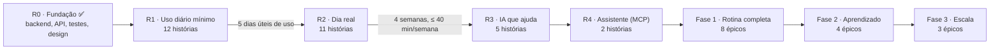

# Plano de desenvolvimento

Plano de produto do Prumo, feito no papel de PO para um ritmo de **um pouco por dia**: cada história cabe em uma sessão de 30 a 60 minutos e entrega algo que dá para ver funcionando. As histórias são agrupadas em pacotes de 2–4, e cada pacote vira um único PR (veja [Pacotes](#pacotes-um-pr-para-várias-histórias)). As issues do GitHub são a fonte da verdade; este arquivo explica a ordem e o porquê.

## Estratégia

1. **Usar cedo.** A primeira entrega (R1) é o mínimo que já muda o seu dia: capturar, clarificar, ver o plano de hoje, focar e concluir. Nada de IA, calendário ou integrações ainda.
2. **O backend já está à frente.** Prioridade, plano em blocos, foco, replanejamento e revisão já existem com testes (R0). As próximas histórias são quase todas de interface, reaproveitando `services.py`.
3. **Interface simples primeiro.** Django templates + HTMX ([ADR 0001](adr/0001-interface-web-com-django-templates-e-htmx.md)): uma linguagem, uma tela por sessão.
4. **Cada release tem critério de saída.** Só passa para a próxima quando o critério for cumprido de verdade, no uso real.

## R0 · Fundação (feito)

Modelo de dados, motor de prioridade, plano do dia em blocos, modo foco, "meu dia quebrou", revisão diária, API REST com isolamento por usuário, 42 testes, CI, documentação e o protótipo de 39 telas.

## R1 · Uso diário mínimo — [marco](https://github.com/BrenoToledo/PRUMO/milestone/1)

**Objetivo:** num dia útil comum, você captura no celular, transforma em tarefa, gera o plano de hoje, foca e conclui.
**Critério de saída:** usado em 5 dias úteis seguidos.

Ordem sugerida (respeita as dependências):

| # | Issue | Tamanho | Por que nessa posição |
| --- | --- | --- | --- |
| 1 | [#1 Base da interface web](https://github.com/BrenoToledo/PRUMO/issues/1) | M | Tudo depende do layout e do login |
| 2 | [#2 Captura rápida por texto](https://github.com/BrenoToledo/PRUMO/issues/2) | P | Primeiro valor: tirar ideias da cabeça |
| 3 | [#3 Caixa de entrada](https://github.com/BrenoToledo/PRUMO/issues/3) | M | Ver e decidir o que foi capturado |
| 4 | [#4 Clarificar em tarefa](https://github.com/BrenoToledo/PRUMO/issues/4) | M | Transforma ideia em próxima ação |
| 5 | [#5 Tela Hoje](https://github.com/BrenoToledo/PRUMO/issues/5) | M | O plano do dia aparece |
| 6 | [#6 Modo foco com timer](https://github.com/BrenoToledo/PRUMO/issues/6) | M | Executar o bloco |
| 7 | [#7 Fim do bloco](https://github.com/BrenoToledo/PRUMO/issues/7) | P | **Ciclo completo: já dá para usar no computador** |
| 8 | [#9 Deploy no homelab](https://github.com/BrenoToledo/PRUMO/issues/9) | M | Acessar de qualquer lugar |
| 9 | [#10 Instalar no celular](https://github.com/BrenoToledo/PRUMO/issues/10) | P | **Uso real no celular: comece a contar os 5 dias** |
| 10 | [#8 Tarefas leves](https://github.com/BrenoToledo/PRUMO/issues/8) | P | Pendências rápidas do fim do dia |
| 11 | [#11 Detalhe e “Por que esta prioridade”](https://github.com/BrenoToledo/PRUMO/issues/11) | M | Confiar na nota |
| 12 | [#12 Configurações do perfil](https://github.com/BrenoToledo/PRUMO/issues/12) | P | O plano caber no seu horário |

Estimativa: cerca de 12 sessões, **2 a 3 semanas** fazendo uma história por dia útil.

## R2 · Dia real — [marco](https://github.com/BrenoToledo/PRUMO/milestone/2)

**Objetivo:** o plano sobrevive a um dia ruim e o dia termina com revisão.
**Critério de saída:** 4 semanas de uso com até 40 minutos por semana dentro do sistema.

| # | Issue | Tamanho |
| --- | --- | --- |
| 1 | [#13 Meu dia quebrou](https://github.com/BrenoToledo/PRUMO/issues/13) | M |
| 2 | [#14 Sair do foco com motivo](https://github.com/BrenoToledo/PRUMO/issues/14) | P |
| 3 | [#15 Anotar distração no foco](https://github.com/BrenoToledo/PRUMO/issues/15) | P |
| 4 | [#17 Revisão diária](https://github.com/BrenoToledo/PRUMO/issues/17) | M |
| 5 | [#19 Editar, adiar e cancelar tarefa](https://github.com/BrenoToledo/PRUMO/issues/19) | P |
| 6 | [#16 Pausa entre blocos](https://github.com/BrenoToledo/PRUMO/issues/16) | P |
| 7 | [#18 Lista rápida](https://github.com/BrenoToledo/PRUMO/issues/18) | P |
| 8 | [#20 Projetos básicos](https://github.com/BrenoToledo/PRUMO/issues/20) | M |
| 9 | [#21 Áreas da vida](https://github.com/BrenoToledo/PRUMO/issues/21) | P |
| 10 | [#22 Preparar foco](https://github.com/BrenoToledo/PRUMO/issues/22) | P |
| 11 | [#23 Hoje no desktop](https://github.com/BrenoToledo/PRUMO/issues/23) | M |

## R3 · IA que ajuda — [marco](https://github.com/BrenoToledo/PRUMO/milestone/3)

[#24 Harness de IA](https://github.com/BrenoToledo/PRUMO/issues/24) → [#25 Pré-preencher clarificação](https://github.com/BrenoToledo/PRUMO/issues/25) → [#26 Quebrar tarefa](https://github.com/BrenoToledo/PRUMO/issues/26) → [#28 Fila assíncrona](https://github.com/BrenoToledo/PRUMO/issues/28) → [#27 Captura por áudio](https://github.com/BrenoToledo/PRUMO/issues/27). Marcadas como *a refinar*: detalhe os critérios antes de começar.

## R4 · Assistente (MCP) — [marco](https://github.com/BrenoToledo/PRUMO/milestone/4)

[#30 Página de tokens](https://github.com/BrenoToledo/PRUMO/issues/30) → [#29 Servidor MCP](https://github.com/BrenoToledo/PRUMO/issues/29).

## Fases 1, 2 e 3 (épicos)

| Fase | Épicos |
| --- | --- |
| [Fase 1 · Rotina completa](https://github.com/BrenoToledo/PRUMO/milestone/5) | [#31 Calendário](https://github.com/BrenoToledo/PRUMO/issues/31) · [#32 Rotinas](https://github.com/BrenoToledo/PRUMO/issues/32) · [#33 Planejamento semanal](https://github.com/BrenoToledo/PRUMO/issues/33) · [#34 Pessoas e follow-up](https://github.com/BrenoToledo/PRUMO/issues/34) · [#35 Revisão semanal](https://github.com/BrenoToledo/PRUMO/issues/35) · [#36 Notificações](https://github.com/BrenoToledo/PRUMO/issues/36) · [#37 Onboarding](https://github.com/BrenoToledo/PRUMO/issues/37) · [#38 LGPD](https://github.com/BrenoToledo/PRUMO/issues/38) |
| [Fase 2 · Aprendizado](https://github.com/BrenoToledo/PRUMO/milestone/6) | [#39 Aderência e padrões](https://github.com/BrenoToledo/PRUMO/issues/39) · [#40 Gatilhos de contexto](https://github.com/BrenoToledo/PRUMO/issues/40) · [#41 WhatsApp/Telegram](https://github.com/BrenoToledo/PRUMO/issues/41) · [#42 E-mail e pauta](https://github.com/BrenoToledo/PRUMO/issues/42) |
| [Fase 3 · Escala](https://github.com/BrenoToledo/PRUMO/milestone/7) | [#43 App nativo](https://github.com/BrenoToledo/PRUMO/issues/43) · [#44 Mapa de stakeholders](https://github.com/BrenoToledo/PRUMO/issues/44) · [#45 Multiusuário e planos](https://github.com/BrenoToledo/PRUMO/issues/45) |

Épicos só são quebrados em histórias quando a fase chegar: o que aprender usando o R1 e o R2 vai mudar o detalhe.

## Definição de Pronto

Uma história está pronta quando:

- [ ] todos os critérios de aceite da issue foram atendidos;
- [ ] regra nova tem teste (`pytest`) e a suíte inteira passa;
- [ ] `ruff check .`, `ruff format --check .` e `makemigrations --check` passam (a CI confere);
- [ ] tela nova foi aberta no celular (390 px) e no desktop;
- [ ] `docs/api.md` foi atualizado se a API mudou;
- [ ] o commit da história está na branch do pacote, e a issue está marcada no checklist do PR (o PR do pacote fecha todas com `Closes #N`).

## Pacotes: um PR para várias histórias

Cada PR dispara a CI (GitHub Actions) e a análise do SonarQube Cloud. Para não gastar execuções com PRs minúsculos, **as histórias são agrupadas em pacotes**: você trabalha uma história por dia, com um commit por história, e abre **um único PR quando o pacote inteiro estiver pronto** (em geral a cada 2–4 sessões).

| Pacote | Histórias | Entrega ao final |
| --- | --- | --- |
| P1 · Entrada | #1, #2, #3 | Login, layout, captura e caixa de entrada |
| P2 · Do item ao plano | #4, #5 | Clarificar e ver o plano de hoje |
| P3 · Execução | #6, #7 | **Foco e fim do bloco: ciclo completo no computador** |
| P4 · No ar | #9, #10 | **Deploy no homelab e uso no celular** |
| P5 · Acabamento R1 | #8, #11, #12 | Tarefas leves, “por que esta prioridade”, perfil |
| P6 · Imprevistos | #13, #14, #15 | Meu dia quebrou, sair do foco, distrações |
| P7 · Fechar o dia | #17, #19, #16 | Revisão diária, editar/adiar/cancelar, pausa |
| P8 · Organização | #18, #20, #21 | Lista rápida, projetos, áreas |
| P9 · Desktop | #22, #23 | Preparar foco e Hoje no desktop |

R3 em diante: defina os pacotes ao refinar as issues, mirando 2–4 histórias por PR.

Regras para economizar CI:

- **Não abra o PR antes da hora.** Faça `git push` da branch todo dia (backup): push em branch sem PR não roda CI. Se quiser abrir o PR cedo para acompanhar, abra como **rascunho** (draft); a CI só roda quando ele for marcado como pronto.
- **Rode os checks localmente** antes de cada commit (`ruff check .`, `ruff format --check .`, `makemigrations --check`, `pytest`). A CI só confirma.
- **Mudanças só em `docs/`, `design/` ou `*.md`** não disparam a CI. Pequenos ajustes de documentação podem ir junto do próximo pacote.
- Correção depois do review: junte todos os ajustes num commit só e faça um push.
- Exceção: um bug que bloqueia o uso diário pode ir num PR próprio (hotfix).

## Como trabalhar a cada dia

1. Pegue a próxima história do pacote atual.
2. No primeiro dia do pacote, crie a branch: `git switch -c pacote-N-descricao` (ex.: `pacote-1-entrada`). Nos dias seguintes, continue nela.
3. Implemente com ajuda do Claude (veja [claude-projeto.md](claude-projeto.md)).
4. Rode os checks localmente e faça **um commit por história**: `feat: captura rápida por texto (#2)`. Dê `git push` (sem abrir PR).
5. Comente na issue o que ficou pronto ou onde parou.
6. Pacote completo → abra **um PR** com uma linha `Closes #N` para cada história, CI verde → merge.

Achou algo novo durante o uso? Crie uma issue com o modelo *História de usuário* e coloque no marco certo (ou sem marco, para triar na revisão semanal).
